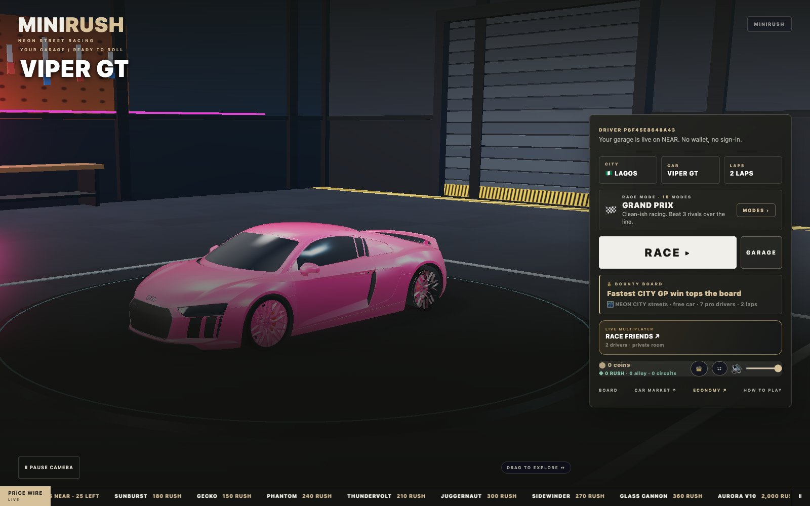
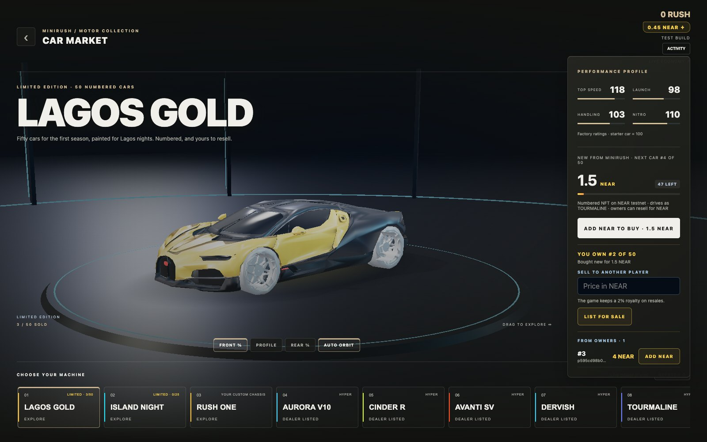
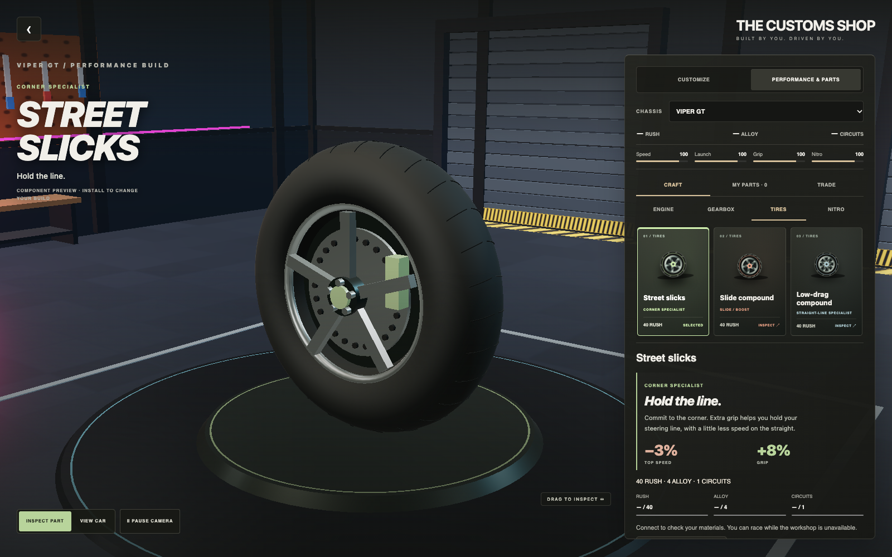
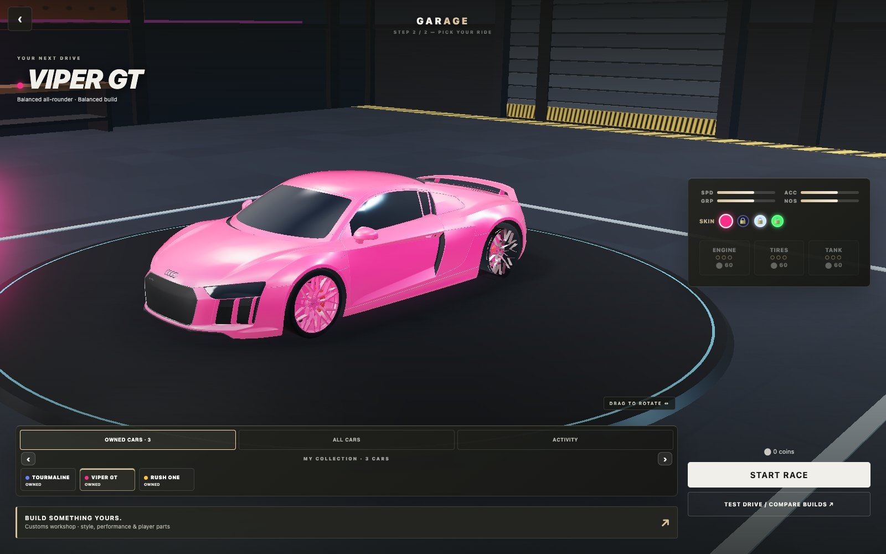
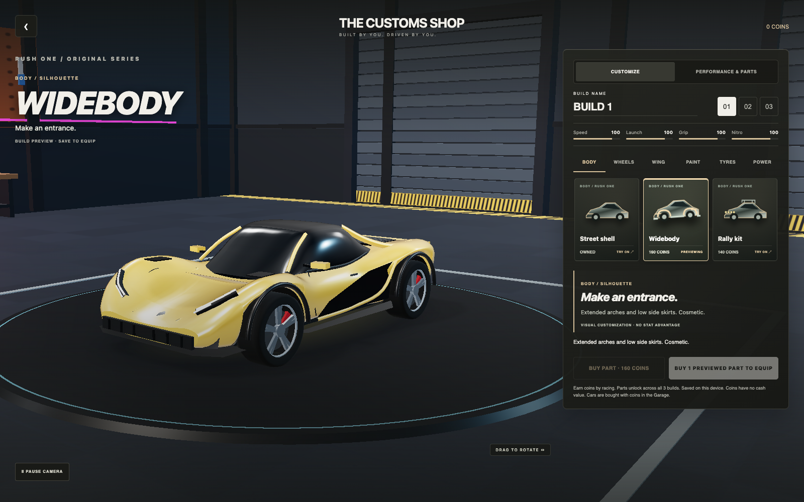
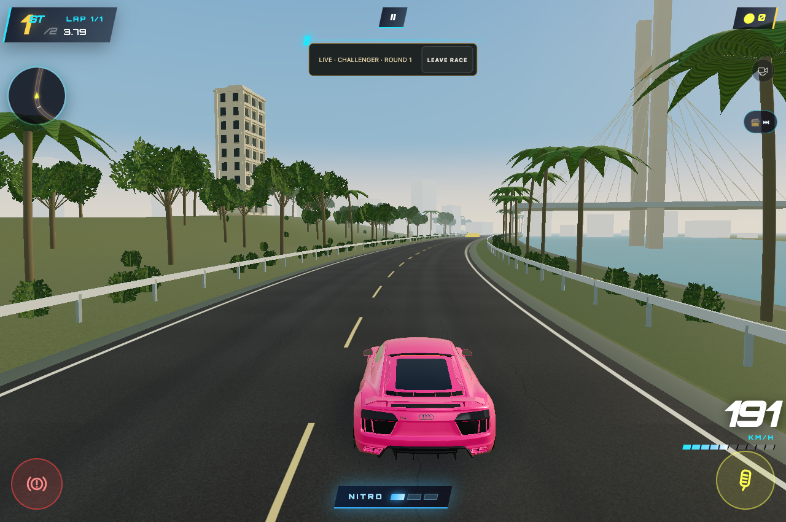
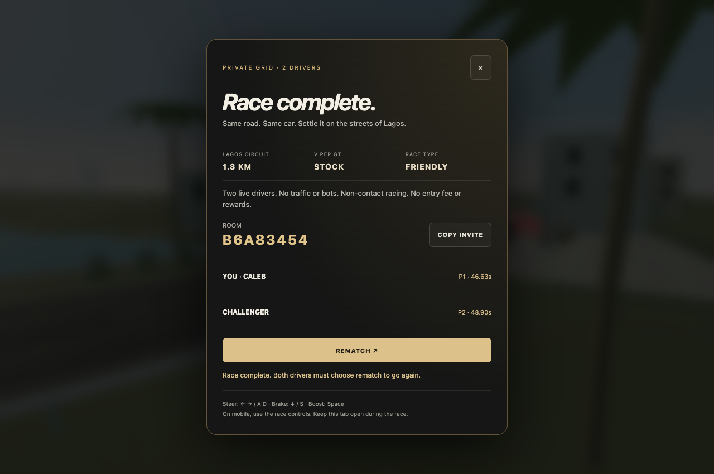
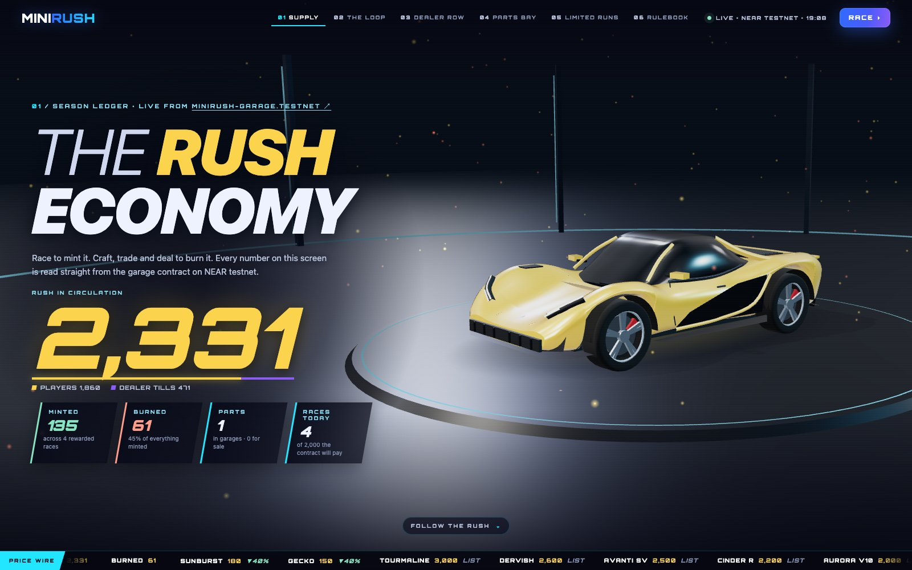
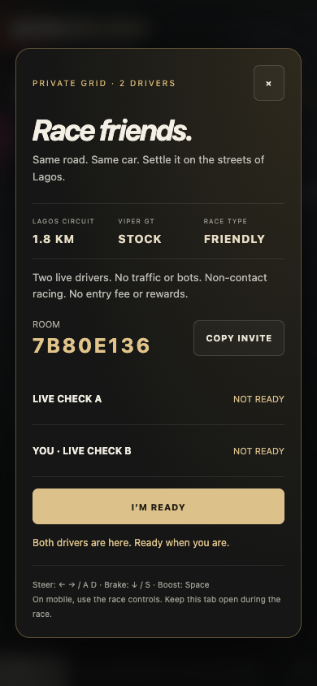
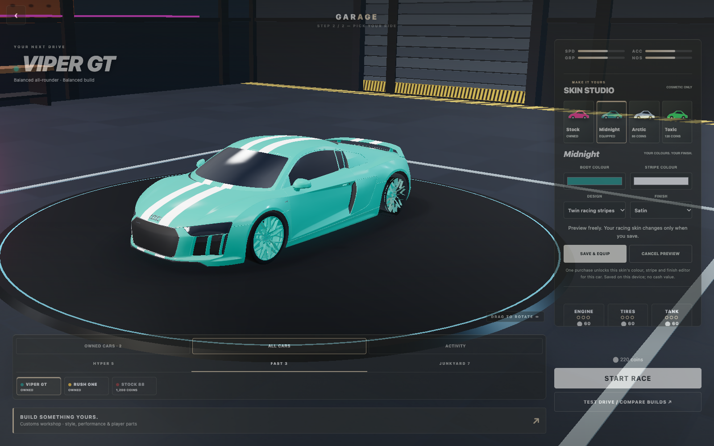

# MiniRush

**Race. Build. Trade. Race again.** A browser racing game with a player-owned car and parts economy on NEAR testnet.

[Play MiniRush](https://minirush.site/) · [Live economy](https://minirush.site/economy/) · [Player stats](https://minirush.site/stats/) · [What is still unfinished](#what-is-still-unfinished)



MiniRush combines arcade driving, private live multiplayer, a multi-car garage,
custom builds, craftable performance parts and dealers that buy and sell from
real inventories. The core loop is **race → earn salvage → craft or trade → fit
a build → test it → race again**. Players can start without a wallet extension,
seed phrase or sign-up. The deployed economy uses `minirush-garage.testnet`;
this is a testnet game, not a mainnet launch.

Built with **Three.js, TypeScript, Vite, Convex and Rust/NEAR**. The frontend uses
ordinary DOM controls alongside the 3D renderer, without a UI framework.

## Screenshots

These are actual game captures, not mockups. Market supply, prices and balances
are snapshots, not promises of current availability. [Capture details and refresh instructions](docs/screenshots/README.md).

| Car market and owner resales | Crafting and performance parts |
| --- | --- |
|  |  |
| **Multi-car garage** | **Customs workshop** |
|  |  |
| **Live multiplayer race** | **Shared race results** |
|  |  |



<details>
<summary>Race Friends on mobile</summary>



</details>

<details>
<summary>Skin Studio: colours, racing stripes and finishes</summary>



Local browser test capture with fixture coins; no on-chain purchase.

</details>

## Try the game

| What to try | Where to go |
| --- | --- |
| A normal race | Home → **Race**; change the event under **Modes** |
| Build your first performance part | Home → **Your next build**; inspect materials, then **Race for materials** or **Craft part** |
| Race another person live | Home → **Race Friends** → **Create a race** → copy the invite; both drivers choose **I'm ready** |
| See your cars | **Garage → Owned cars**; **All cars** shows the broader roster |
| Customize RUSH ONE | **Garage → Customs workshop → Customize** |
| Buy and personalize a skin | **Garage → select a car → Skin Studio → select a skin** |
| Craft, install or sell parts | **Garage → Customs workshop → Performance & Parts** |
| Fill an NPC buy order | **Performance & Parts → Trade → Dealer orders** |
| Buy a numbered car from another player | **Car Market → choose a limited edition → From Owners** |
| Compare stock and fitted handling | **Garage → Test drive / Compare builds** |
| Inspect the economy without playing | [Economy page](https://minirush.site/economy/), or the homepage **Price Wire** |

**Current guest policy:** guests can race, buy, craft and trade. Shopping does
not currently require Google sign-in. A garage key is created and kept in this
browser when the backend is available. Clearing browser storage can lose access
to that garage; cross-device recovery is not implemented.

## Features built

### Driving and world

- **Closed, seeded circuits** with selectable laps, grid starts, lap tracking,
  race standings, a heading-up minimap and results. Ordinary circuit races have
  no civilian traffic or buses; opponents come from the performance-car roster.
- **Arcade handling:** acceleration, braking, coasting, corner forces, off-road
  slowdown, grip-dependent steering, wet-weather grip, ramp jumps and landings.
- **Power drifting and nitro:** brake plus steer to charge a drift, release for
  a short boost, and earn more nitro through the style gauge. Near misses,
  drafting/slipstream boosts and takedowns reward the appropriate race styles.
- **Racecraft and combat:** rivals check passing space, follow, defend and brake
  for corners; combat modes add intentional contact, wrecks or weapons.
- **20 selectable environments/circuits:** Lagos, Kaduna, Beijing, Mumbai,
  Neon City, London, Tokyo, Rio de Janeiro, Cairo, Nairobi, Seoul, Accra,
  São Paulo, Norway, Iceland, Canada, New Zealand, Finland, Cartoon Oval and
  Lone Star GP. City architecture, road layouts, vegetation and weather vary.
- **Presentation:** chase, low-bumper, TV and driver cameras; impact cinematics,
  drift smoke, boost effects, weather, engine sounds and music. NEON FM adds
  internet radio. Adaptive render resolution and quality tiers support a range
  of devices; physical-phone performance is still a separate testing task.
- **Controls:** touch steering and pedals, keyboard, gamepad navigation and
  driving, camera switching, fullscreen, pause in solo play, and reduced-motion
  support for showroom/interface animations.

### Race modes and events

The circuit roster currently contains **12 modes**, plus open-city activities,
daily events and the separate live multiplayer flow.

| Mode | Current experience |
| --- | --- |
| Grand Prix | Player plus three AI rivals |
| Burnout | Eight-car contact racing, nitro takedowns and wrecks |
| Police Chase | Escape four pursuing units over three laps; manage heat |
| Gun Run | Six-car armed race with tire shots and ammo pickups |
| Time Attack | One-lap solo run against your saved best ghost |
| Eliminator | Eight-car aggressive sprint; periodic last-place elimination is not implemented |
| Pack Attack | Six racers, tight gaps and late braking |
| Armored Heist | Attack the lead target for loot and a wreck bonus |
| Hyper Cup | Six-car, two-lap hypercar class event |
| Voltage Surge | Continuous nitro access with a draining battery |
| Hardcore | Seven pro rivals on a longer circuit; restricted entry |
| Weekend GP | Eight laps against pro AI and recorded player ghosts; weekend board, midweek practice |

Other ways to play:

- **Race Friends:** two live human drivers in a private room, invite link or
  eight-character code, ready checks, loading barrier and shared countdown.
  Both drive stock Viper GTs on Lagos. Live position updates, shared results,
  rematches, short-refresh recovery and disconnect/DNF handling are implemented.
  This mode is non-contact and awards no coins, RUSH, salvage or prizes.
- **Daily Run:** a shared daily circuit and score board, with local streak rewards.
- **Recorded challenges:** share a completed run through a `?c=` link; another
  player races its ghost on the same circuit and setup. These are replays, unlike
  live **Race Friends** invites (`?race=`).
- **Neon City free roam:** a road network, civilian traffic, exploration tokens,
  unlocks, map activities and street races.
- **Passenger driving:** accept fares, collect animated passengers, follow GPS
  routes and reach drop-offs against the clock.
- **City GP / Bounty Board:** an eight-car, two-lap checkpoint race through Neon
  City. Weekly fastest-win boards support organizer-configured prizes and manual
  verification/fulfilment; there is no automatic on-chain prize payout. The
  standalone City GP mode card is a development preview.
- **Progression and sharing:** local bests and ghosts, daily/weekend/bounty boards,
  driver names, badges, race statistics, map passport unlocks, referral bonuses
  and shareable run receipts.

### Garage and customization

- Own more than one car, browse by class and switch between **Owned cars** and
  **All cars**. Local purchases and on-chain entitlements feed the drivable roster.
- Inspect cars in rotating home, garage and market stages with manual orbit and
  camera presets. These screens and the workshop/results share the game's card styling.
- Build the original **RUSH ONE** chassis: bodywork, wheels, wing, paint, tyres
  and power options; live preview; named builds; three saved preset slots;
  **Save & equip**. Cosmetic choices and performance tuning are distinguished.
- **Cinematic parts inspection:** rotating 3D tires, engines, gearboxes and nitro
  bottles; **Inspect part / View car** controls; illustrated customization and
  inventory cards; driving notes and explicit gains/costs for all 12 recipes.
  Street slicks, Slide compound and Low-drag compound have distinct tread and
  wheel treatments. Browsing never equips or spends resources. Camera motion
  can be paused and respects reduced-motion preferences.
- Ordinary car upgrades, paint and cosmetic workshop parts use local earned
  coins. Interrupted local purchases recover from a browser journal.
- **Skin Studio:** preview a skin, choose body and stripe colours, switch between
  solid paint and twin racing stripes, and select gloss or satin. **Buy & equip**
  unlocks an editable skin slot for that car; later edits are free. **Cancel
  preview** leaves the racing loadout unchanged, and **Equip factory** restores
  the original look (Customs paint on RUSH ONE). Supports VIPER GT, RUSH ONE,
  STOCK 88 and all five Hypercars. Legacy junkyard liveries are not editable;
  their skin purchases are blocked. Skins are cosmetic, device-local purchases
  with earned coins, not on-chain NFTs. Private friend races retain their fixed
  opponent colours.
- **Test drive / Compare builds** provides a fixed dry Lagos proving ground with
  fitted and stock runs. Reports show lap time, 0–100, peak speed, braking,
  off-road time and nitro use. Practice does not spend consumables or earn rewards.
- **Your next build** connects the homepage, confirmed material balances, race
  results and the tracked recipe. The workshop shows resource shortfalls and
  prepares a standard Grand Prix through **Race for materials**. Funded demand
  appears beside matching recipes and owned parts, so players can choose between
  fitting a part and supplying a dealer.

### NEAR economy, ownership and markets

| System | What is implemented |
| --- | --- |
| Multi-token ledger | RUSH, stackable materials, dealer cars and supplies; NEP-245 core transfer/balance/supply functionality |
| Race salvage | Eligible connected circuit finishes earn RUSH, alloy and circuits under account/global budgets |
| Crafting | 12 recipes across engine, gearbox, tires and nitro; crafting burns RUSH and materials |
| Component NFTs | Individually numbered parts with owner, original maker, recipe and crafting timestamp; NFT transfer, metadata and enumeration methods |
| Loadouts | Four slots on VIPER GT and RUSH ONE; explicit benefits and tradeoffs; fresh ownership/loadout reads before normal races |
| Recycling | Burn a part to recover half its crafting materials, rounded down; no RUSH refund |
| Player parts market | List, cancel and buy components; ownership/payment settle together; stale-offer protection and a burned trade fee |
| NPC dealers | Mama T, Oga Motors and Tuner Ade have accounts, inventories and RUSH budgets; scheduled repricing records a reason |
| Funded dealer orders | Dealers reserve existing RUSH to buy player-crafted parts; players deliver exact serials; acquired stock can be resold |
| Limited-edition cars | LAGOS GOLD: 50-car run at 1.5 test NEAR; ISLAND NIGHT: 25-car run at 0.75 test NEAR; numbered NFT ownership |
| Owner car resales | **From Owners** listings for edition cars, asking prices, cancellation, purchase and a 2% resale royalty retained by the game |
| Testnet top-up | A limited, one-time **Get test NEAR** grant per garage, subject to backend daily caps and available game funds |
| Activity and recovery | Status and receipts for tracked relayed actions, retry/recovery for pending claims, and confirmed balance refreshes |
| Economy visibility | Live supply, mint/burn totals, crafting, recycling, trade volume, dealer stock/funds, price-change reasons and edition revenue |
| Homepage Price Wire | Edition and dealer prices plus owner-listing count; pause, reduced motion and stale/offline labels |

Eligible circuit rewards currently pay **45 / 36 / 30 / 24 RUSH** by fixed
payout tier, plus **2 alloy and 1 circuit**. A podium bonus requires a grid of at
least three rivals; solo/pursuit finishes receive the plain finish rate. Race
sessions must meet duration/progress checks. Practice, Race Friends and City GP
do not use this circuit-salvage reward path.

Component sales burn a 2% RUSH fee, with a minimum of 1 RUSH. Edition cars use
test NEAR instead: primary proceeds and the 2% resale royalty stay with the game.
Local coins, on-chain RUSH/materials and test NEAR are separate balances. RUSH is
earned, not sold. None of this testnet economy promises cash value or redemption.

**Dealer behavior is bounded, not magic:** the component buyer uses deterministic
inventory/budget rules. Car repricing supports an optional LLM endpoint with a
rules fallback. Dealer wallets spend existing funds; the existence of this policy
does not establish long-term economic balance. Prices and stock can evolve
without a developer patch; crafting recipes are still code-defined.

### Making the chain unobtrusive

The default flow creates a browser-held garage key and sponsors supported
contract actions, so racing, crafting and ordinary trading need no wallet popup.
Paid edition purchases are signed by the garage and sent directly, using its own
test NEAR. The market still shows explicit prices, balances and pending states;
chain failures are recoverable UI states rather than fabricated successes.

NEAR Auth/Google integration exists as an **optional preview**. It is disabled
on the live site: the shared testnet client's hosted-origin/callback allowlist
has not been resolved for `minirush.site`. Local authentication and optional
identity-to-garage proof work do **not** provide cross-device account recovery.

## What is still unfinished

These are the remaining work items, not features advertised as shipped.

| Priority | Gap | Next concrete step |
| --- | --- | --- |
| Before competitive rewards | Authoritative race validation | Move decisive race progress/results to server simulation or verified replay. Current telemetry checks cannot prove a real race occurred; solo reward placement is client-reported. |
| Next multiplayer milestone | Public matchmaking and larger grids | Add a queue, four-player rooms, connection/load testing and clear latency handling. Current live rooms support two friends only, without contact or rewards. |
| Account continuity | Hosted Google sign-in and garage recovery | Resolve hosted Auth0 origin/callback configuration, then implement secure identity-bound recovery. Browser keys remain device-local today. |
| Hackathon integration gap | NEAR Intents | Design and implement an actual intent-based transaction flow. The current marketplace uses direct contract calls and sponsored relays, not NEAR Intents. |
| Economy readiness | Balance and abuse resistance | Simulate emission/sink/dealer solvency over time; strengthen bot/Sybil controls and account-funding/gas budgets. |
| Versioning and interoperability | Stable recipes/rules and external NFT compatibility | Version recipes and competitive records; verify third-party wallet/marketplace behavior. Optional NFT approvals and royalty-standard extensions are not implemented. |
| Recovery polish | Failed/expired claim cleanup | Add a safe discard path for permanently failed claims and better handling of ambiguous paid-purchase results. |
| Device and scale validation | Real-device performance and multiplayer load | Profile physical Android/iOS devices, slow connections and multiple simultaneous rooms. Browser screenshots are not performance certification. |
| Mode completeness | Eliminator's knockout rule | Implement periodic last-place elimination; the present mode is an aggressive sprint. |
| Separate future launch | Mainnet readiness | Prune old on-chain race reward records without enabling replay; revisit the 0.01 NEAR account grant; measure storage/gas and build size; complete security review, network configuration and production auth. |

**Already completed:** the testnet contract upgrade, migration rehearsal, limited
edition launch, coordinated backend/frontend deployment and real testnet
purchase/resale checks. Those are not outstanding deployment tasks. Testnet is
the hackathon target; mainnet is a separate decision.

## Run locally

Use **Node.js 24**, npm and a modern browser with WebGL support. Chrome is needed
for the repository's browser checks; Rust/Cargo are needed only for contract work.

```sh
npm install
npm run dev:auth
# http://localhost:3000 — use localhost exactly for the optional auth preview

# Alternative LAN-accessible development server:
npm run dev

# Typecheck and build the static frontend:
npm run build
npm run preview -- --host localhost --port 4173 --strictPort
```

For connected features, copy `.env.example` to `.env.local` if you do not already
have local configuration, and set `VITE_CONVEX_URL` to your Convex deployment.
`npx convex dev --once` initializes/updates your development backend. A frontend
without a configured backend still supports local racing, but cannot provide live
rooms, shared boards or the complete connected economy.

| Configuration | Purpose |
| --- | --- |
| `VITE_CONVEX_URL` | Public frontend URL for your Convex deployment |
| `VITE_NEAR_GARAGE`, `VITE_NEAR_RPC` | Optional public overrides for the testnet garage/RPC |
| Backend `NEAR_GARAGE`, `NEAR_RPC` | Contract/network used by Convex actions |
| Backend `NEAR_GAME_KEY`, `NEAR_DEALER_KEYS` | Secret signing credentials; set in Convex, never in frontend variables or Git |
| Backend `NEAR_DEALER_AGENTS_ENABLED` | Run dealers on only one deployment if development and production share dealer keys |
| `VITE_SHOP_SIGN_IN=required` and backend `SHOP_SIGN_IN=required` | Optional sign-in gate; both sides must agree; default is off |

See [.env.example](.env.example) and [NEAR setup, auth and rollout notes](docs/near-economy.md)
for the remaining settings. Deploy the contract, backend and frontend together
when adding contract-dependent features; a plain static build does not create or
upgrade contracts.

### Controls

| Action | Keyboard / desktop | Touch |
| --- | --- | --- |
| Accelerate | W / ↑ | Hold gas pedal |
| Steer | A / D or ← / → | Drag or hold steering input |
| Brake / drift | S / ↓; steer while braking to drift | Brake pedal plus steering |
| Nitro / weapon | Space; N for nitro in armed modes | Tap / nitro control; armed modes change the tap action |
| Camera | C | Camera button |
| Pause | P / Esc, solo play | Pause button, solo play |

Live races cannot pause. Keep the tab active; a disconnect longer than 20 seconds
marks a driver DNF. Race Friends rooms expire after 45 minutes and each race has
a four-minute limit. Both drivers must opt into a rematch.

Developer query parameters include `?seed=7`, `?laps=4`, `?len=1800`,
`?map=lagos`, `?mode=burnout` and `?q=1`. Ordinary lap length is clamped to
600–5,000 metres; some events lock the route, laps or car rules.

## Verification

```sh
npm run build
npm run check:economy-server
npm run check:race-rules
npm run check:friend-rules
```

With the local game running and Chrome installed:

```sh
npm run check:market -- http://localhost:3000
npm run check:parts -- http://localhost:3000
npm run check:test-drive -- http://localhost:3000
npm run check:editions -- http://localhost:3000
npm run check:friends -- http://localhost:3000
```

`check:friends` uses real development Convex rooms and blocks NEAR transactions.
Avoid editing code during it: hot reload interrupts races. The rule checks cover
seat ownership, room capacity, loading/start barriers, progress bounds, replay,
finish order, rematch isolation, disconnects and expiry. The two-browser check
also exercises actual driving, refresh recovery, mobile layout and shared results.
Other browser suites use isolated backend/chain fixtures; inspect each script's
header before treating a fixture result as on-chain verification.

Contract and auth/recovery checks:

```sh
cargo test --manifest-path contracts/near/Cargo.toml
npm run check:garage-recovery
npm run check:identity-proof
npm run check:dealer-orders -- http://localhost:3000
npm run check:handling-rivals -- http://localhost:3000
```

Real testnet integration and migration scripts are documented in
[the economy notes](docs/near-economy.md); they create accounts and send testnet
transactions. `scripts/stress.mjs` is a legacy real-CELO transaction script,
**not** a harmless game load test.

Refresh the read-only documentation screenshots with:

```sh
node scripts/capture-readme.mjs
# Optional: node scripts/capture-readme.mjs http://localhost:3000
```

## Repository map

| Path | Responsibility |
| --- | --- |
| `src/game.ts`, `src/player.ts`, `src/rivals.ts` | Race loop, driving and AI racecraft |
| `src/city/` | Open-city roads, traffic, activities, fares and City GP |
| `src/ui.ts`, `src/market.ts`, `src/workshopUI.ts`, `src/partsWorkshop.ts` | Menus, garage, market and build flows |
| `src/friendRace.ts`, `shared/friendRace.ts`, `convex/friends.ts` | Live multiplayer UI, shared rules and room backend |
| `src/near.ts`, `src/garageActivity.ts` | Garage account access, transactions and recovery UI |
| `convex/` | Rooms, boards, reward validation, relays and dealer automation |
| `contracts/near/` | Rust garage contract, token ledger, components, orders and editions |
| `shared/components.json` | Shared crafting catalogue and stat changes |
| `economy/`, `src/economyPage.ts`, `src/homePriceWire.ts` | Public ledger presentation and price wire |
| `scripts/` | Browser/contract integration checks and asset tooling |
| `docs/` | Design, operating notes and screenshot assets |

Further reading: [economy and rollout](docs/near-economy.md),
[hackathon demo and recording walkthrough](docs/hackathon-demo.md),
[customs, handling and test drive](docs/customs-workshop.md),
[Weekend GP](docs/weekend-gp.md), [recorded challenges](docs/challenges.md),
[weekly bounty](docs/bounty.md), [asset guide](public/assets/README.md).
Older milestone notes in the design documents may describe pre-deployment work;
the dated rollout status at the top of the economy notes takes precedence.

## Art, history and licence

MiniRush uses imported 3D assets, procedural cars/scenery and generated lighting.
Asset packs retain their own licences: see [CREDITS.md](CREDITS.md),
[model credits](public/assets/models/CREDITS.txt) and [the asset guide](public/assets/README.md).
Source code is [MIT licensed](LICENSE).

The non-NEAR Foundry contracts under `contracts/` are retained from the earlier
Celo tracker. They are not the current game economy. The old Outbreak/zombie
branding and removed horde mode do not describe the current racing loop.
