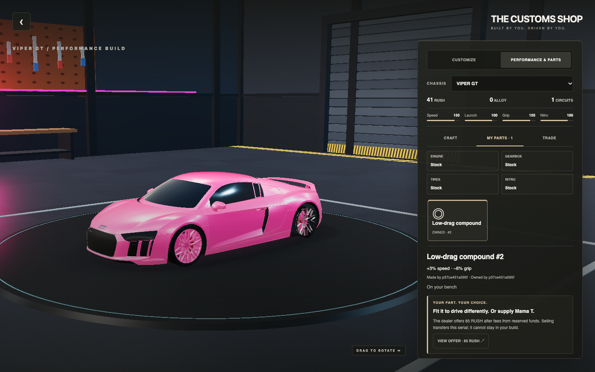

# MiniRush economy demonstration

The story: **a race creates a resource; a player makes a useful part; a funded
dealer or another driver becomes the customer.** The part can change a car's
handling, and its maker credit survives resale.

## A short presentation

Aim for a two-to-three-minute edit, keeping the uncut recording and public
transaction receipts available. Label sped-up racing or time cuts. Start from
the game UI, with the chain details available when someone asks to inspect them.

| Time | Show | Explain |
| --- | --- | --- |
| 0:00–0:20 | Homepage and **Your next build** | “You start with a car. Race to earn the resources for your next part. No wallet extension or sign-up.” |
| 0:20–0:40 | A funded order and its recipe | “This dealer wants stock and has already reserved the money. I can build what the market needs.” |
| 0:40–1:10 | Actual racing, then confirmed salvage | “Racing supplies RUSH, alloy and circuits. The target shows what is still missing.” |
| 1:10–1:35 | Craft and inspect the numbered part | “Crafting consumes resources and creates this particular part. I made it; I choose where it goes.” |
| 1:35–2:05 | Fit it **or** deliver to a dealer | “Keeping it changes my driving tradeoffs. Selling it moves the same serial to the dealer and pays me from their funds.” |
| 2:05–2:30 | Updated inventory, payment and maker credit | “Dealers respond to inventory and available funds. They can resell player-made stock; they do not conjure parts or unlimited money.” |
| Optional | Race Friends lobby or a separate real race clip | “Two people can race live in private rooms. Multiplayer currently awards no economy rewards.” |

Do not promise a one-race craft. From an empty garage, the default Street slicks
need two eligible finishes for their four alloy, even when the first race is a
win. Other recipes can need more. Daily limits and connection failures still
apply. Use the confirmed balances shown in the interface.

## Manual rehearsal

1. Run the current frontend with a configured testnet backend. Use a dedicated
   test browser profile and keep it between rehearsals; it contains the garage
   key. Do not clear it or copy its contents into a submission.
2. Open **Your next build → Trade → Dealer orders**. Choose an active, affordable
   order and **View recipe & track materials**. The offer may fill or expire.
   If no dealer needs stock, demonstrate the install path honestly.
3. Choose **Race for materials**, then **Start race**. This prepares a standard
   two-lap Grand Prix with VIPER GT. Finish normally, allow at least 40 seconds,
   and wait for confirmed salvage. Repeat only as needed.
4. From results, open the tracked recipe. Craft once the confirmed resources
   cover the cost. Inspect the serial, maker and performance tradeoff.
5. Choose a path: install and compare fitted/stock handling, or open the funded
   offer and deliver. Show the confirmed outcome. Never retry a purchase just
   because it is slow; check **Activity** first.
6. For a sale, show the dealer's reduced outstanding order and updated player
   balance. A subsequent scheduled dealer review can list that part for resale;
   reviews are not instantaneous. Preserve its serial to demonstrate provenance.

## Repeatable real testnet capture

```sh
npm run dev:auth
# In another terminal, after reviewing the script:
node scripts/record-economy-demo.mjs --send http://localhost:3000
```

This is an integration demonstration, **not a mocked test**. It uses a dedicated
profile at `/tmp/minirush-demo-browser`, creates a garage if needed, drives up to
three races through normal input/physics, crafts one part and delivers it to an
available dealer or installs it. It spends testnet resources. No mainnet use is
supported. Do not edit frontend files while it runs: hot reload interrupts races.

The script records to `/tmp/minirush-economy-demo/economy-demo-raw.webm` and writes
timestamps plus public transaction links to `evidence.json`. The recording uses
automated steering; it never sets position, race time, finishing place or wallet
balances. Describe it as automated driving when sharing it. Keep profiles private;
only recordings, screenshots and public receipts belong in a submission.

For isolated UI regression tests that send no NEAR transactions, run
`npm run check:dealer-orders -- http://localhost:3000` and
`npm run check:race-workshop -- http://localhost:3000`. Their fixtures are not
evidence of live settlement.

## Honest answers for judges

- The deployed economy targets NEAR **testnet**. Local coins, RUSH/materials and
  test NEAR are separate resources.
- NPC component demand uses inventory and budget rules; it is not a claim that
  unconstrained AI controls the economy. Recipes remain code-defined.
- Browser-held garage keys make the first session unobtrusive. Cross-device
  recovery and hosted Google authentication remain unfinished.
- Race telemetry has checks, but competitive results are not yet authoritative.
  Live multiplayer has no prize or salvage payout.
- NEAR Intents is not implemented. Show the actual multi-token, component
  ownership, sponsored actions and funded market flows instead.

## Verified recording: 13 November 2026

The local frontend completed two normal-physics races against the development
backend with real NEAR testnet settlement. The dedicated garage earned 81 RUSH,
4 alloy and 2 circuits, then consumed 40 RUSH, 4 alloy and 1 circuit to craft
**Low-drag compound #2**. Mama T bought that serial for **85 RUSH after fees**.
The final public read confirmed Mama T as owner, the demo garage as original
maker, and 126 RUSH plus 1 circuit remaining in the demo garage.

| Action | Public receipt |
| --- | --- |
| First race reward | [NEAR testnet transaction](https://testnet.nearblocks.io/txns/2jdpcfZRd2d4Q3bzGZbkY4xAUebtnHScgWavmnN1ne9G) |
| Second race reward | [NEAR testnet transaction](https://testnet.nearblocks.io/txns/8mUoaypATSJa3afKQC4wg7pcVJboKKcy3tbq1YmSBTaA) |
| Craft component #2 | [NEAR testnet transaction](https://testnet.nearblocks.io/txns/D9mf1fYhHo1Gjwif4jBXG6fEU31eCNJ5m5iQGk9UhWbp) |
| Deliver to Mama T | [NEAR testnet transaction](https://testnet.nearblocks.io/txns/AbnxoJgkXK8hjS9qTWJnAkr3dWgQzAB2x5uuD6hNDWZY) |

[Recorded steps and final public state](demo-evidence.json) accompany the
receipts. The uncut capture is about 3 minutes 50 seconds. The presentation edit
is about 2 minutes 25 seconds, with race segments at 2× speed and an explicit
automation/speed label. Both are local artifacts under
`/tmp/minirush-economy-demo/`; videos and private browser profiles are not committed.


